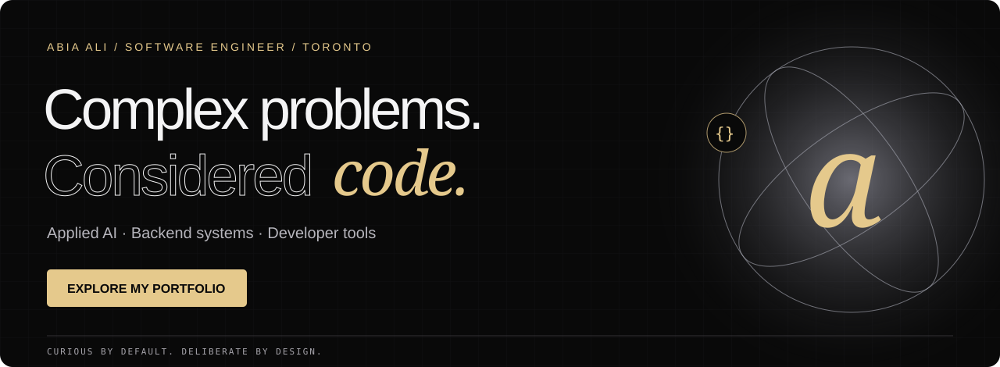
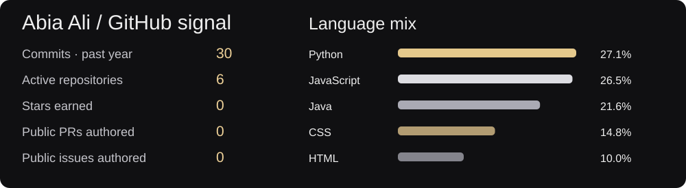
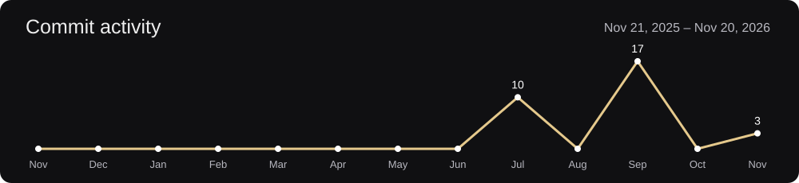

<a href="https://abiaali0.github.io/abiaali0/">
  
</a>

<p align="center">
  <a href="https://abiaali0.github.io/abiaali0/"><strong>Interactive portfolio</strong></a> &nbsp; · &nbsp;
  <a href="https://abiaali0.github.io/abiaali0/#lab">Play with an algorithm</a> &nbsp; · &nbsp;
  <a href="https://www.linkedin.com/in/abia-a-bab209265/">LinkedIn</a> &nbsp; · &nbsp;
  <a href="mailto:aabia013@gmail.com">Get in touch</a>
</p>

### Hi, I'm Abia.

I'm a **Computer Science student and software engineer in Toronto**, exploring applied AI, backend infrastructure, and developer tools. I enjoy turning ambitious ideas into software with clear interfaces, thoughtful trade-offs, and tests for the things that can go wrong.

**My approach:** understand the problem → make the design explicit → build → test → refine.

## Selected work

**[Try all five project demos](https://abiaali0.github.io/abiaali0/showcase.html)**

[Task queue](https://abiaali0.github.io/abiaali0/showcase.html#queue) · [Issue planner](https://abiaali0.github.io/abiaali0/showcase.html#agent) · [Code analyzer](https://abiaali0.github.io/abiaali0/showcase.html#analyzer) · [Résumé matcher](https://abiaali0.github.io/abiaali0/showcase.html#match) · [Fraud rules](https://abiaali0.github.io/abiaali0/showcase.html#fraud)


<table>
<tr>
<td width="50%" valign="top">
<h3>Work that keeps moving.</h3>
<strong><a href="https://github.com/abiaali0/distributed-task-queue">Distributed Task Queue</a></strong>
<p>Asynchronous workers, persistent job state, and exponential-backoff retries. Follow a job from API submission to stored result.</p>
<code>Python</code> <code>FastAPI</code> <code>Celery</code> <code>Redis</code> <code>PostgreSQL</code>
</td>
<td width="50%" valign="top">
<h3>From issue to intention.</h3>
<strong><a href="https://github.com/abiaali0/ai-software-engineer-agent">AI Software Engineer Agent</a></strong>
<p>Structured issue analysis, keyword-based repository context, and implementation plans that make the next step clearer.</p>
<code>Python</code> <code>FastAPI</code> <code>Pytest</code> <code>Docker</code>
</td>
</tr>
<tr>
<td valign="top">
<h3>Trust, by design.</h3>
<strong><a href="https://github.com/abiaali0/secure-fraud-auth-system">Fraud Detection &amp; Authentication</a></strong>
<p>JWT authentication, role-based access, rule-based transaction scoring, and persistent audit events.</p>
<code>Java</code> <code>Spring Boot</code> <code>PostgreSQL</code>
</td>
<td valign="top">
<h3>Read between the lines.</h3>
<strong><a href="https://github.com/abiaali0/static-code-analyzer">Static Code Analyzer</a></strong>
<p>A Python AST-based CLI for unused imports, mutable defaults, broad exceptions, and risky calls. Text and JSON reporting.</p>
<code>Python</code> <code>AST</code> <code>CLI</code> <code>Pytest</code>
</td>
</tr>
<tr>
<td valign="top">
<h3>Make the match explainable.</h3>
<strong><a href="https://github.com/abiaali0/ai-resume-job-match">Resume &amp; Job Match Platform</a></strong>
<p>Transparent keyword matching, weighted scores, and actionable feedback through a React frontend and FastAPI backend.</p>
<code>React</code> <code>Python</code> <code>FastAPI</code>
</td>
<td valign="top">
<h3>Don't just scroll. Experiment.</h3>
<strong><a href="https://abiaali0.github.io/abiaali0/#lab">The interactive playground</a></strong>
<p>Draw a maze. Watch breadth-first search find a shortest path. Explore project case studies, search with ⌘/Ctrl K, and switch themes.</p>
<code>JavaScript</code> <code>Algorithms</code> <code>Accessible UI</code>
</td>
</tr>
</table>

<sub>Descriptions reflect the current public implementations. Each repository documents its scope and future work.</sub>


## Go deeper.

<a href="https://abiaali0.github.io/abiaali0/#lab"></a>

### Choose your route

| Explore the systems | Inspect the thinking | Run the experiment |
| :--- | :--- | :--- |
| **[Backend & infrastructure](https://github.com/abiaali0/distributed-task-queue)** | **[Code analysis & developer tools](https://github.com/abiaali0/static-code-analyzer)** | **[BFS versus A* playground](https://abiaali0.github.io/abiaali0/#lab)** |
| Follow a job through an API, a queue, a worker, and persistent state. | See how source code becomes a syntax tree and actionable findings. | Build walls, choose a layout, and compare how two algorithms explore the same problem. |
| FastAPI · Redis · Celery · PostgreSQL | Python · AST · CLI · Tests | Editable grid · Four layouts · Exploration counts |

### Think like an engineer

Three small problems. Make your prediction, then open the explanation.

<details>
<summary><strong>01 / A worker finishes a job, then crashes before acknowledging it. What happens next?</strong></summary>

The queue may deliver the job again. A retry is useful, but the side effect could happen twice.

**The design question:** can the operation be made idempotent? A stable job identifier, a uniqueness constraint, and an atomic state transition can help prevent duplicate effects. External actions may also need an idempotency key.

**The trade-off:** retries improve resilience, but do not automatically provide exactly-once execution.

[Explore the task queue implementation](https://github.com/abiaali0/distributed-task-queue)

<sub>This is a design discussion, not a claim that every mitigation is implemented in the repository.</sub>

</details>

<details>
<summary><strong>02 / Can two shortest-path algorithms return the same answer while doing very different amounts of work?</strong></summary>

Yes. **BFS** expands outward in layers. **A*** uses the distance travelled plus a heuristic estimate of the distance remaining.

On this unweighted, four-directional grid, Manhattan distance is an admissible, consistent heuristic. Both algorithms find a shortest path when one exists. A* can explore fewer cells, although the advantage depends on the walls and tie-breaking.

**Try it:** run the open field, then the slalom layout. Compare the exploration counts and path length.

[Run the interactive comparison](https://abiaali0.github.io/abiaali0/#lab)

</details>

<details>
<summary><strong>03 / Why does a Python function remember items from an earlier call?</strong></summary>

Consider:

```python
def collect(item, bucket=[]):
    bucket.append(item)
    return bucket
```

The default list is created once, when the function is defined. Calls that omit `bucket` share that same list.

```python
def collect(item, bucket=None):
    if bucket is None:
        bucket = []
    bucket.append(item)
    return bucket
```

**The engineering lesson:** behaviour can be valid Python and still be surprising. A syntax-tree rule can flag mutable defaults before that surprise becomes a bug.

[Inspect the static analyzer](https://github.com/abiaali0/static-code-analyzer)

</details>

### Open the toolbox

<details>
<summary><strong>Languages & application layers</strong></summary>

| Layer | Tools |
| :--- | :--- |
| Languages | Python · TypeScript · JavaScript · Java · SQL |
| Applications | FastAPI · React · Spring Boot |
| Infrastructure | PostgreSQL · Redis · Celery · Docker |
| Quality | Automated tests · GitHub Actions · API documentation |

</details>

<details>
<summary><strong>From a question to a working system</strong></summary>

1. **Frame the problem.** Who needs this, and what does success look like?
2. **Define the boundaries.** Inputs, outputs, failure modes, and data ownership.
3. **Build a small complete path.** Make the central workflow executable.
4. **Challenge the happy path.** Test invalid inputs, retries, and missing data.
5. **Explain the trade-offs.** Document what works, what is limited, and what comes next.

</details>

<details>
<summary><strong>The questions I want to explore next</strong></summary>

- How can retrieval systems make their answers easier to verify?
- Where do AI-assisted development workflows need human review?
- How should background systems recover without duplicating work?
- What makes an evaluation useful beyond a polished demo?

These are areas of interest, rather than claims of completed implementations.

</details>

## GitHub signal



**30 authored commits across 6 public repositories · [5 runnable project demos](https://abiaali0.github.io/abiaali0/showcase.html)**



### Contribution snake


<sub>Snapshot through November 20, 2026. The chart and gold calendar squares count authored commits on the default branches of my public repositories over the preceding year. Stars are summed across those repositories. PR and issue counts cover public authored items. Language percentages use tracked source-file bytes by extension.</sub>

## Build log

Open a milestone to see what changed and inspect the commit.

<details>
<summary><strong>Nov 2026 · Five projects became runnable</strong></summary>

Visitors can edit inputs and inspect outputs from the project cards. The Python analyzer parses the visitor’s sample in the browser.

[Inspect this change](https://github.com/abiaali0/abiaali0/commit/3224d9d44e1bc6ea62d6946cad0f774045e359e2)

</details>

<details>
<summary><strong>Nov 2026 · Engineering challenges came to the profile</strong></summary>

The README gained prediction prompts about retries, shared state, and search. Each opens directly on GitHub.

[Inspect this change](https://github.com/abiaali0/abiaali0/commit/dee8cb0b28bedd111e21a584ff4596bf9448fbb1)

</details>

<details>
<summary><strong>Nov 2026 · The pathfinding lab gained a second algorithm</strong></summary>

BFS and A* now run against the same walls. The lab reports how many cells each explores, alongside the length of the shortest route.

[Inspect this change](https://github.com/abiaali0/abiaali0/commit/aeedbc1398908b2d3b86b03076d7c381f491dc76)

</details>

<details>
<summary><strong>Nov 2026 · The portfolio launched</strong></summary>

The first release connected five public repositories to case studies, added keyboard search, and introduced the editable maze.

[Inspect this change](https://github.com/abiaali0/abiaali0/commit/59b6bcf90dae84ce4ba4a80fce15a9f82307f53a)

</details>

## Research notebook

I’m interested in what happens when a small change to an input changes a system’s answer. Pick an experiment, make a prediction, then open the observation.

| Experiment | Change one thing | Run it |
| :--- | :--- | :--- |
| Retrieval relevance | Rename a file while keeping the issue text fixed | [Issue planner](https://abiaali0.github.io/abiaali0/showcase.html#agent) |
| Explainable scoring | Add one required skill to a sample résumé | [Résumé matcher](https://abiaali0.github.io/abiaali0/showcase.html#match) |
| Recovery after failure | Interrupt a worker processing the same four numbers | [Queue simulator](https://abiaali0.github.io/abiaali0/showcase.html#queue) |

<details>
<summary><strong>Retrieval · Can a filename alone change the plan?</strong></summary>

Use the issue title `CSV export`, the description `Export reports`, and two file paths, `app/export_csv.py` and `app/helpers.py`. Run it once. Rename the first file to `app/io.py` and run it again.

**Observation.** The first run retrieves `app/export_csv.py`. The second returns no matching files. The planner scores words in paths, so a relevant module with an uninformative name can disappear from its context.

**What I’d measure next.** On a labelled set of issues, how often does the correct file appear in the first five results?

</details>

<details>
<summary><strong>Scoring · How much is one missing skill worth?</strong></summary>

Set the job description to `Python Redis Docker` and the résumé to `Python Docker`. Predict the score, then add `Redis` to the résumé.

**Observation.** The score moves from **66.7% to 100%**. All three terms carry equal weight here. The score measures keyword coverage, so adding a single word changes it even without evidence of experience.

**What I’d measure next.** How often does a high score correspond to a résumé that actually demonstrates the skill?

</details>

<details>
<summary><strong>Reliability · Does a retry change the answer?</strong></summary>

Submit `10, 20, 30, 40` twice. Turn on **Simulate transient failures** for the second run. Compare the event histories before looking at the results.

**Observation.** The second history includes two retries. Both results still contain four values, a sum of **100**, and an average of **25**. Repeating this calculation preserves its result. An operation that sends an email or writes a payment would need a separate check for duplicate effects.

**What I’d measure next.** For a real worker pool, how much do retries increase completion time under load?

</details>

### A portfolio you can actually explore

**[Open the full experience](https://abiaali0.github.io/abiaali0/)** · Search with **⌘ / Ctrl K** · Open project case studies · Compare algorithms · Switch between light and dark

<sub>The expandable sections work here on GitHub. The live simulations run on the linked portfolio.</sub>

---

<a href="mailto:aabia013@gmail.com"></a>

<p align="center"><a href="mailto:aabia013@gmail.com"><strong>Let's talk</strong></a> &nbsp; · &nbsp; <a href="https://www.linkedin.com/in/abia-a-bab209265/">LinkedIn</a> &nbsp; · &nbsp; <a href="https://abiaali0.github.io/abiaali0/">Explore the portfolio</a></p>
